<p align="center">
  
</p>

<p align="center">
  
  
  
  
  
</p>

<p align="center">
  <a href="#-food">Food</a> •
  <a href="#-drinks">Drinks</a> •
  <a href="#-recipes">Recipes</a> •
  <a href="#-installation">Installation</a> •
  <a href="CHANGELOG.md">Changelog</a>
</p>

---

## 🌮 Food

Every taco is always edible, even on a full stomach.

| | Item | Hunger | Effects (30 s unless noted) |
|:-:|---|:-:|---|
|  | **Beef Taco** | 13 | Health Boost · Speed · Strength |
|  | **Chicken Taco** | 13 | Haste V |
|  | **Pork Taco** | 13 | Health Boost · Speed · Strength |
|  | **Fish Taco** | 13 | Luck (2 min) · Dolphin's Grace |
|  | **Crunchwrap Supreme** | 13 | Resistance II · Speed III · Fire Resistance II |
|  | **Suspicious Taco** | 6 |  Zombie Disguise (1 min) — you look like a zombie |

### 🤢 Side effects

Street food comes with risks. Each roll is independent.

| Effect | Regular tacos | Suspicious Taco |
|---|:-:|:-:|
| Hunger | 20% · 10 s | **100%** · 60 s |
| Nausea | 7.5% · 5 s | 50% · 30 s |
| Poison | 2.5% · 5 s | 10% · 20 s |

## 🥤 Drinks

Drinks are brewed as potions, so they also come as **splash**, **lingering**, and **tipped arrow** variants.

| | Drink | Effect |
|:-:|---|---|
|  | **Baja Blast** |  **Flight** for 3 min — fly like in Creative mode |
|  | **Mountain Dew** | **Haste VIII** for 3 min — instamines deepslate with an Efficiency V netherite pickaxe |
|  | **Dr Pepper** | **23 Flavors** — one random outcome, good or very bad (see below) |

<details>
<summary><b>🎲 Dr Pepper's 23 flavors</b></summary>
<br>

| 😋 Good (12) | 😵 Bad (11) |
|---|---|
| Speed II (30 s) | Slowness (30 s) |
| Haste II (30 s) | Nausea (10 s) |
| Strength (30 s) | Blindness (10 s) |
| Regeneration (30 s) | Poison (10 s) |
| Resistance (30 s) | Levitation (5 s) |
| Fire Resistance (30 s) | Darkness (10 s) |
| Night Vision (30 s) | Teleported to the End |
| Absorption II (30 s) | Teleported to the Nether |
| An Ancient Debris | Struck by lightning |
| 10 XP levels | 20 Phantoms spawn |
| A random enchanted book | ☠️ Instant death (rare, ~0.5%) — *"drank one flavor too many"* |
| Teleported to the nearest player | |

Flavors that can't apply (e.g. a Nether teleport while already in the Nether) are skipped and re-rolled.
</details>

## 📖 Recipes

These are the exact screens you'll see in game. Shaped recipes work anywhere in the grid as long as the shape stays the same.
**✋ 2×2 OK** means it also fits the crafting grid in your inventory.

<details>
<summary><b>🗺️ Crafting overview: everything on one page</b></summary>
<br>
<p align="center">
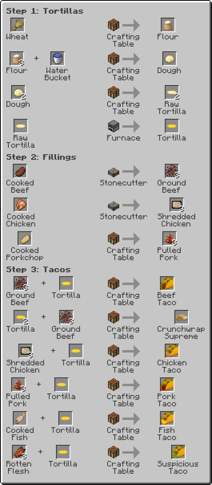
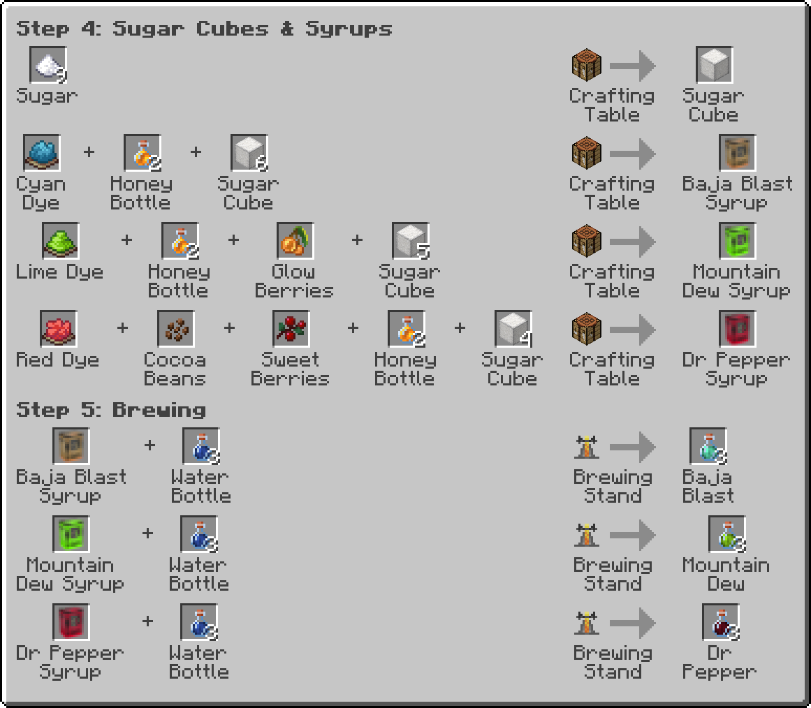
</p>
</details>

### 1 · Tortillas

<table>
<tr>
<td align="center" width="50%">
<b>Flour</b> · ✋ 2×2 OK<br>
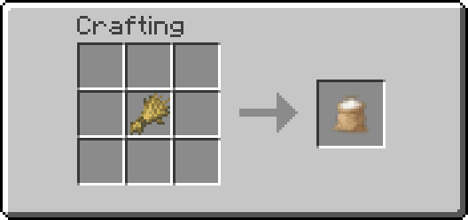<br>
<sub>1 Wheat ➜ 1 Flour</sub>
</td>
<td align="center" width="50%">
<b>Dough</b> · ✋ 2×2 OK<br>
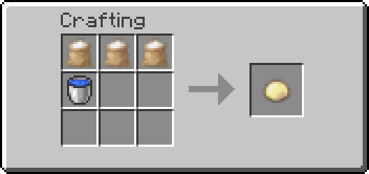<br>
<sub>3 Flour + 1 Water Bucket, any slots. You keep the bucket.</sub>
</td>
</tr>
<tr>
<td align="center" width="50%">
<b>Raw Tortilla</b> · ✋ 2×2 OK<br>
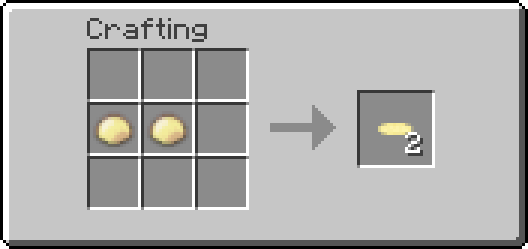<br>
<sub>2 Dough side by side ➜ <b>2</b> Raw Tortillas</sub>
</td>
<td align="center" width="50%">
<b>Tortilla</b> · Furnace<br>
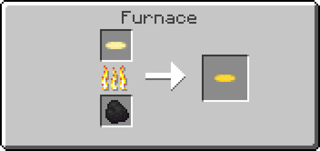<br>
<sub>Smelt a Raw Tortilla (5 s, any fuel)</sub>
</td>
</tr>
</table>

### 2 · Fillings

One cooked meat always makes the 3 pieces of filling a taco needs.

<table>
<tr>
<td align="center" width="50%">
<b>Ground Beef</b> · Stonecutter<br>
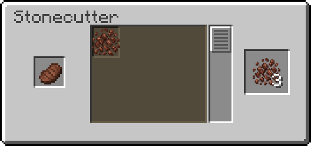<br>
<sub>1 Cooked Beef ➜ <b>3</b> Ground Beef</sub>
</td>
<td align="center" width="50%">
<b>Shredded Chicken</b> · Stonecutter<br>
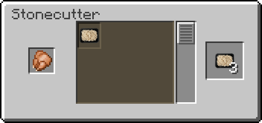<br>
<sub>1 Cooked Chicken ➜ <b>3</b> Shredded Chicken</sub>
</td>
</tr>
<tr>
<td align="center" width="50%">
<b>Pulled Pork</b> · ✋ 2×2 OK<br>
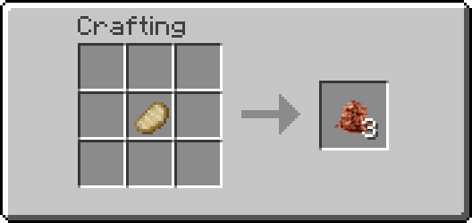<br>
<sub>1 Cooked Porkchop ➜ <b>3</b> Pulled Pork</sub>
</td>
<td></td>
</tr>
</table>

### 3 · Tacos

<table>
<tr>
<td align="center" width="50%">
<b>Beef Taco</b><br>
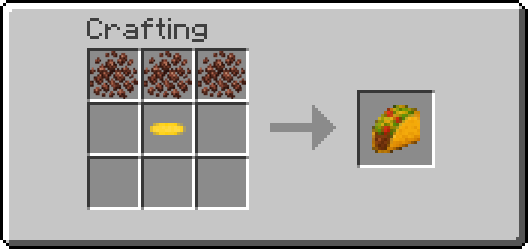<br>
<sub>3 Ground Beef over a Tortilla</sub>
</td>
<td align="center" width="50%">
<b>Chicken Taco</b><br>
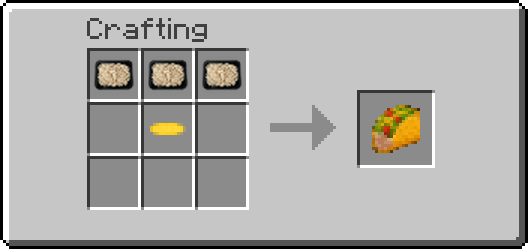<br>
<sub>3 Shredded Chicken over a Tortilla</sub>
</td>
</tr>
<tr>
<td align="center" width="50%">
<b>Pork Taco</b><br>
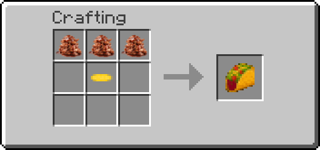<br>
<sub>3 Pulled Pork over a Tortilla</sub>
</td>
<td align="center" width="50%">
<b>Fish Taco</b> · ✋ 2×2 OK<br>
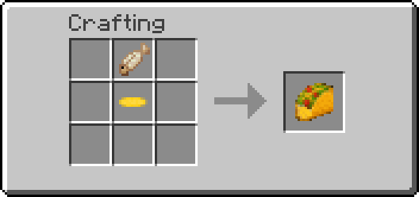<br>
<sub>Cooked Cod <b>or</b> Cooked Salmon over a Tortilla</sub>
</td>
</tr>
<tr>
<td align="center" width="50%">
<b>Crunchwrap Supreme</b><br>
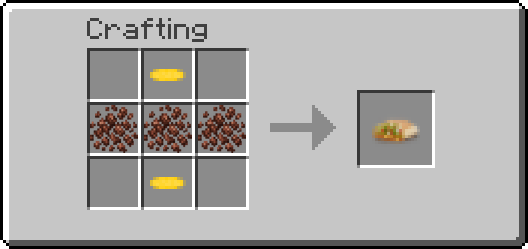<br>
<sub>3 Ground Beef between 2 Tortillas</sub>
</td>
<td align="center" width="50%">
<b>Suspicious Taco</b><br>
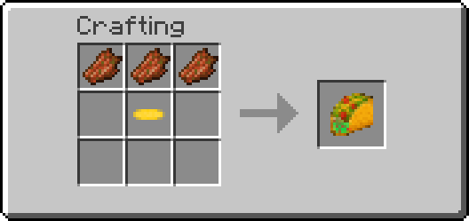<br>
<sub>3 Rotten Flesh over a Tortilla</sub>
</td>
</tr>
</table>

### 4 · Sodas

Make Sugar Cubes, craft a syrup (any slots), then brew it into Water Bottles.
Soda syrups brew slowly: **10 minutes** per batch.

<table>
<tr>
<td align="center" width="50%">
<b>Sugar Cube</b><br>
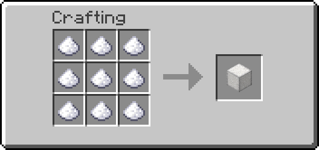<br>
<sub>9 Sugar ➜ 1 Sugar Cube</sub>
</td>
<td align="center" width="50%">
<b>Baja Blast Syrup</b><br>
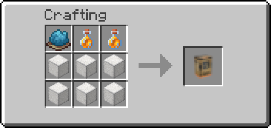<br>
<sub>Cyan Dye + 2 Honey Bottles + 6 Sugar Cubes</sub>
</td>
</tr>
<tr>
<td align="center" width="50%">
<b>Mountain Dew Syrup</b><br>
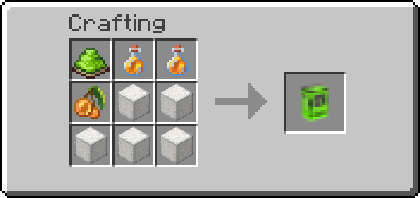<br>
<sub>Lime Dye + 2 Honey Bottles + Glow Berries + 5 Sugar Cubes</sub>
</td>
<td align="center" width="50%">
<b>Dr Pepper Syrup</b><br>
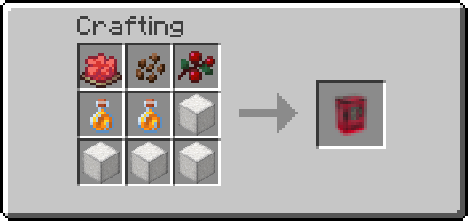<br>
<sub>Red Dye + Cocoa Beans + Sweet Berries + 2 Honey Bottles + 4 Sugar Cubes</sub>
</td>
</tr>
</table>

<p align="center">
<b>Baja Blast</b><br>
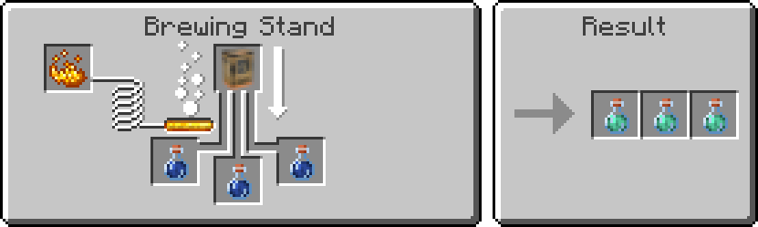<br>
<sub>Baja Blast Syrup + Water Bottles</sub>
</p>

<p align="center">
<b>Mountain Dew</b><br>
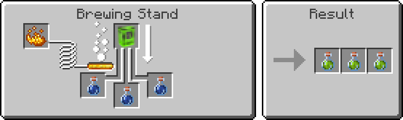<br>
<sub>Mountain Dew Syrup + Water Bottles</sub>
</p>

<p align="center">
<b>Dr Pepper</b><br>
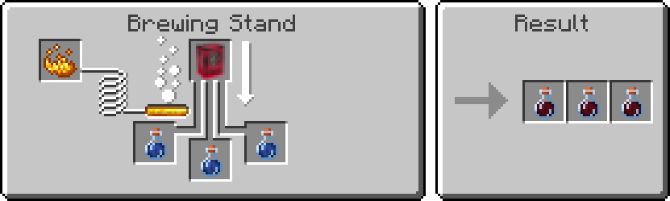<br>
<sub>Dr Pepper Syrup + Water Bottles</sub>
</p>

## 📦 Installation

1. Install [Fabric Loader](https://fabricmc.net/use/) **0.19.5+** for Minecraft **26.3**.
2. Drop [Fabric API](https://modrinth.com/mod/fabric-api) and the Tacos Mod `.jar` into your `mods` folder.
3. Launch the game. Every item lives in its own **Tacos** creative tab.

### Building from source

```sh
./gradlew build   # requires Java 25; the jar is written to build/libs/
```

The README images in `docs/images` are generated with Pillow from the mod's textures plus a vanilla Minecraft client jar (for the GUI and vanilla items):

```sh
python3 scripts/render_recipe_images.py --jar path/to/26.3.jar      # recipe screens + overview trees
python3 scripts/generate_readme_images.py --jar path/to/26.3.jar    # banner + item icons
```

Without `--jar`, `render_recipe_images.py` looks for the launcher's jar in `.minecraft/versions`.

## 📜 License

[GPL-3.0](LICENSE)
