<p align="center">
  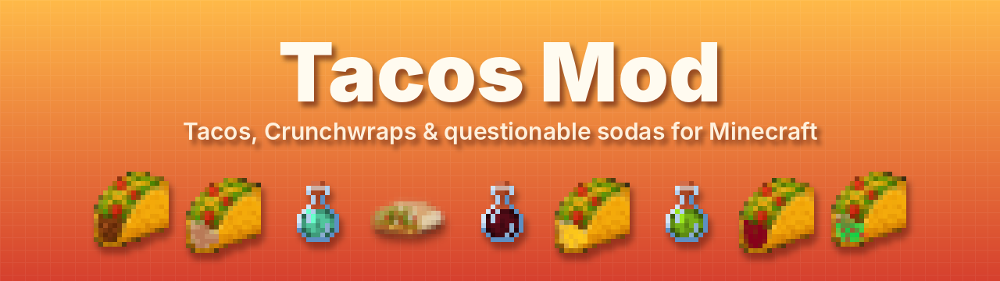
</p>

<p align="center">
  
  
  
  
  
</p>

<p align="center">
  <a href="#-food">Food</a> •
  <a href="#-drinks">Drinks</a> •
  <a href="#-recipes">Recipes</a> •
  <a href="#-installation">Installation</a> •
  <a href="CHANGELOG.md">Changelog</a>
</p>

---

## 🌮 Food

Every taco is always edible, even on a full stomach.

| | Item | Hunger | Effects (30 s unless noted) |
|:-:|---|:-:|---|
| 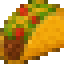 | **Beef Taco** | 13 | Health Boost · Speed · Strength |
| 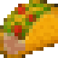 | **Chicken Taco** | 13 | Haste V |
| 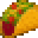 | **Pork Taco** | 13 | Health Boost · Speed · Strength |
| 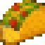 | **Fish Taco** | 13 | Luck (2 min) · Dolphin's Grace |
| 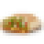 | **Crunchwrap Supreme** | 13 | Resistance II · Speed III · Fire Resistance II |
| 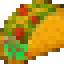 | **Suspicious Taco** | 6 |  Zombie Disguise (1 min) — you look like a zombie |

### 🤢 Side effects

Street food comes with risks. Each roll is independent.

| Effect | Regular tacos | Suspicious Taco |
|---|:-:|:-:|
| Hunger | 20% · 10 s | **100%** · 60 s |
| Nausea | 7.5% · 5 s | 50% · 30 s |
| Poison | 2.5% · 5 s | 10% · 20 s |

## 🥤 Drinks

Drinks are brewed as potions, so they also come as **splash**, **lingering**, and **tipped arrow** variants.

| | Drink | Effect |
|:-:|---|---|
|  | **Baja Blast** |  **Flight** for 3 min — fly like in Creative mode |
|  | **Mountain Dew** | **Haste VIII** for 3 min — instamines deepslate with an Efficiency V netherite pickaxe |
|  | **Dr Pepper** | **23 Flavors** — one random outcome, good or very bad (see below) |

<details>
<summary><b>🎲 Dr Pepper's 23 flavors</b></summary>
<br>

| 😋 Good (12) | 😵 Bad (11) |
|---|---|
| Speed II (30 s) | Slowness (30 s) |
| Haste II (30 s) | Nausea (10 s) |
| Strength (30 s) | Blindness (10 s) |
| Regeneration (30 s) | Poison (10 s) |
| Resistance (30 s) | Levitation (5 s) |
| Fire Resistance (30 s) | Darkness (10 s) |
| Night Vision (30 s) | Teleported to the End |
| Absorption II (30 s) | Teleported to the Nether |
| An Ancient Debris | Struck by lightning |
| 10 XP levels | 20 Phantoms spawn |
| A random enchanted book | ☠️ Instant death (rare, ~0.5%) — *"drank one flavor too many"* |
| Teleported to the nearest player | |

Flavors that can't apply (e.g. a Nether teleport while already in the Nether) are skipped and re-rolled.
</details>

## 📖 Recipes

### Ingredients

| | Result | Recipe | Station |
|:-:|---|---|---|
| 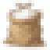 | **Flour** | 1 Wheat | Crafting |
|  | **Sugar Cube** | 9 Sugar (fill the 3×3 grid) | Crafting |
|  | **Dough** | 3  Flour + 1 Water Bucket | Crafting (shapeless) |
|  | **Raw Tortilla** ×2 | 2  Dough side by side | Crafting |
|  | **Tortilla** | 1  Raw Tortilla | Furnace |
| 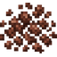 | **Ground Beef** ×3 | 1 Cooked Beef | Stonecutter |
| 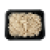 | **Shredded Chicken** ×3 | 1 Cooked Chicken | Stonecutter |
| 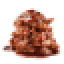 | **Pulled Pork** ×3 | 1 Cooked Porkchop | Crafting |

### Tacos

All tacos are made on a Crafting Table.

<table>
<tr>
<td align="center">
<b>Beef Taco</b><br><br>
<table>
<tr><td></td><td></td><td></td></tr>
<tr><td></td><td></td><td></td></tr>
</table>
➜ 
</td>
<td align="center">
<b>Chicken Taco</b><br><br>
<table>
<tr><td></td><td></td><td></td></tr>
<tr><td></td><td></td><td></td></tr>
</table>
➜ 
</td>
<td align="center">
<b>Pork Taco</b><br><br>
<table>
<tr><td></td><td></td><td></td></tr>
<tr><td></td><td></td><td></td></tr>
</table>
➜ 
</td>
</tr>
<tr>
<td align="center">
<b>Fish Taco</b><br><br>
<table>
<tr><td align="center"><sub>Cooked Cod<br>or Salmon</sub></td></tr>
<tr><td align="center"></td></tr>
</table>
➜ 
</td>
<td align="center">
<b>Crunchwrap Supreme</b><br><br>
<table>
<tr><td></td><td></td><td></td></tr>
<tr><td></td><td></td><td></td></tr>
<tr><td></td><td></td><td></td></tr>
</table>
➜ 
</td>
<td align="center">
<b>Suspicious Taco</b><br><br>
<table>
<tr><td align="center"><sub>Rotten<br>Flesh</sub></td><td align="center"><sub>Rotten<br>Flesh</sub></td><td align="center"><sub>Rotten<br>Flesh</sub></td></tr>
<tr><td></td><td></td><td></td></tr>
</table>
➜ 
</td>
</tr>
</table>

### Drinks

Craft the syrup (shapeless), then brew it into a **Water Bottle** in a Brewing Stand.
Soda syrups brew slowly: **10 minutes** per batch.

| | Syrup | Ingredients | | Brews into |
|:-:|---|---|:-:|---|
|  | **Baja Blast Syrup** | 6  Sugar Cube · 2 Honey Bottle · 1 Cyan Dye |  | Baja Blast |
|  | **Mountain Dew Syrup** | 5  Sugar Cube · 2 Honey Bottle · 1 Glow Berries · 1 Lime Dye |  | Mountain Dew |
|  | **Dr Pepper Syrup** | 4  Sugar Cube · 2 Honey Bottle · 1 Cocoa Beans · 1 Sweet Berries · 1 Red Dye |  | Dr Pepper |

## 📦 Installation

1. Install [Fabric Loader](https://fabricmc.net/use/) **0.19.5+** for Minecraft **26.3**.
2. Drop [Fabric API](https://modrinth.com/mod/fabric-api) and the Tacos Mod `.jar` into your `mods` folder.
3. Launch the game. Every item lives in its own **Tacos** creative tab.

### Building from source

```sh
./gradlew build   # requires Java 25; the jar is written to build/libs/
```

The README graphics in `docs/images` are generated from the mod's textures with `python3 docs/generate_images.py` (requires Pillow).

## 📜 License

[GPL-3.0](LICENSE)
