# Minecraft Tacos Mod

Mod that adds tacos to Minecraft :D

Cook up tacos, crunchwraps, and questionable sodas, each with its own effects.

- [New Food & Drink Items](#new-food--drink-items)
- [Crafting Guide](#crafting-guide)
  - [Your First Taco in 5 Steps](#your-first-taco-in-5-steps)
  - [Crafting Trees](#crafting-trees)
  - [Step-by-Step Recipes](#step-by-step-recipes)
  - [Shopping List](#shopping-list)
  - [Finding the Vanilla Ingredients](#finding-the-vanilla-ingredients)

## New Food & Drink Items

| Item                    | Hunger Restored | Abilities |
| ----------------------- | --------------- | --------- |
| **Baja Blast Potion**   | —               | Grants Flight for 3 minutes. |
| **Beef Taco**           | 13              | Health Boost, Speed, and Strength for 30 seconds. 20% chance of Hunger for 10 seconds, 7.5% chance of Nausea for 5 seconds, and 2.5% chance of Poison for 5 seconds. |
| **Chicken Taco**        | 13              | Haste V for 30 seconds. 20% chance of Hunger for 10 seconds, 7.5% chance of Nausea for 5 seconds, and 2.5% chance of Poison for 5 seconds. |
| **Crunchwrap Supreme**  | 13              | Resistance II, Speed III, and Fire Resistance II for 30 seconds. 20% chance of Hunger for 10 seconds, 7.5% chance of Nausea for 5 seconds, and 2.5% chance of Poison for 5 seconds. |
| **Dr Pepper Potion**    | —               | One of 23 random flavors. Good: Speed, Haste, Strength, Regeneration, Resistance, Fire Resistance, Night Vision, Absorption, an Ancient Debris, 10 XP levels, a random enchanted book, or teleporting to the nearest player. Bad: Slowness, Nausea, Blindness, Poison, Levitation, Darkness, getting struck by lightning, 20 Phantoms, teleporting to the End or the Nether, or (rarely) instant death. |
| **Fish Taco**           | 13              | Luck for 2 minutes and Dolphin's Grace for 30 seconds. 20% chance of Hunger for 10 seconds, 7.5% chance of Nausea for 5 seconds, and 2.5% chance of Poison for 5 seconds. |
| **Mountain Dew Potion** | —               | Grants Haste VIII for 3 minutes — enough to instantly mine deepslate with an Efficiency V netherite pickaxe. |
| **Pork Taco**           | 13              | Health Boost, Speed, and Strength for 30 seconds. 20% chance of Hunger for 10 seconds, 7.5% chance of Nausea for 5 seconds, and 2.5% chance of Poison for 5 seconds. |
| **Suspicious Taco**     | 6               | Gives Zombie Disguise and Hunger for 1 minute. 50% chance of Nausea for 30 seconds, and 10% chance of Poison for 20 seconds. |

## Crafting Guide

### Your First Taco in 5 Steps

Every taco starts with a **Tortilla**, so that's the place to begin.

1. Craft **6 Wheat** into **6 Flour** (each Wheat makes 1 Flour).
2. Craft **3 Flour + 1 Water Bucket** into **1 Dough**. You get the empty bucket back, so refill it and make a second Dough.
3. Put the **2 Dough** side by side to get **2 Raw Tortillas**.
4. Smelt the Raw Tortillas in a **Furnace** to get **Tortillas**.
5. Put **1 Cooked Beef** in a **Stonecutter** for **3 Ground Beef**, then put the beef across the top row of a Crafting Table with a Tortilla under the middle for a **Beef Taco**.

> **Tip:** One Cooked Beef, Cooked Chicken, or Cooked Porkchop always makes exactly the 3 pieces of filling one taco needs.

### Crafting Trees

Each row is one recipe: **ingredients ➜ where to make it ➜ what you get**. The small number on a slot is how many you need, or how many you get. Work from the top down: everything a row needs was made in a row above it, or is a vanilla item.

<p align="center">
  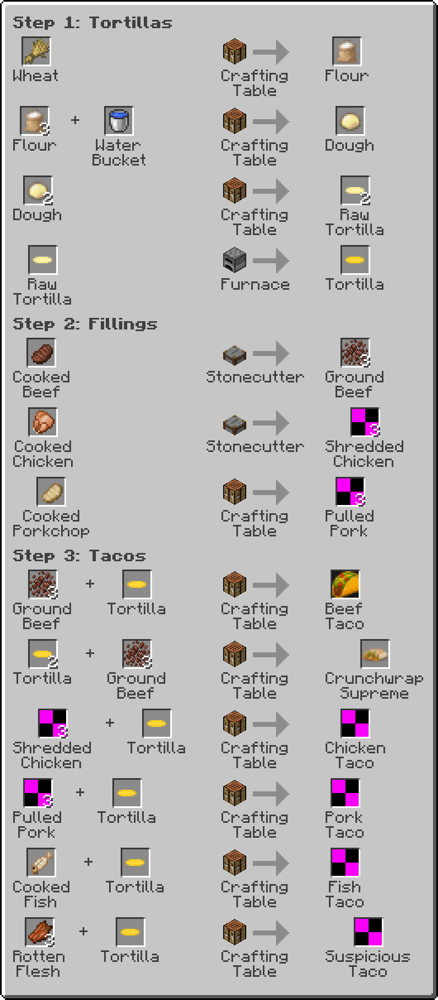
</p>

<p align="center">
  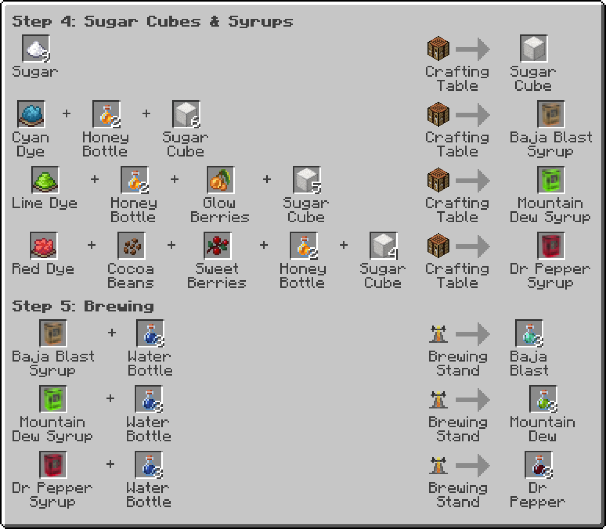
</p>

### Step-by-Step Recipes

These are the exact screens you'll see in game. **✋ Inventory OK** means the recipe also fits in the 2×2 crafting grid in your inventory. Shaped recipes can sit anywhere in the grid as long as the shape stays the same. Recipes marked **any layout** only need the right items, in any slots.

#### Step 1: Tortillas

<table>
  <tr>
    <td align="center" width="50%">
      <b>Flour</b> · ✋ Inventory OK<br>
      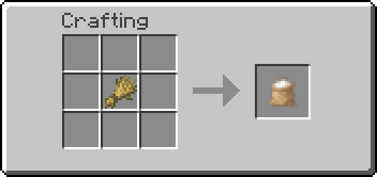<br>
      1 Wheat ➜ 1 Flour
    </td>
    <td align="center" width="50%">
      <b>Dough</b> · ✋ Inventory OK · any layout<br>
      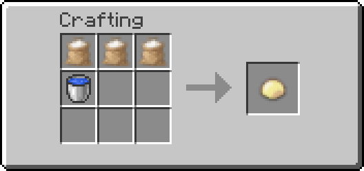<br>
      3 Flour + 1 Water Bucket ➜ 1 Dough<br><sub>You get the empty bucket back.</sub>
    </td>
  </tr>
  <tr>
    <td align="center">
      <b>Raw Tortilla</b> · ✋ Inventory OK<br>
      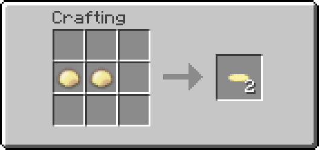<br>
      2 Dough side by side ➜ <b>2</b> Raw Tortillas
    </td>
    <td align="center">
      <b>Tortilla</b> · Furnace<br>
      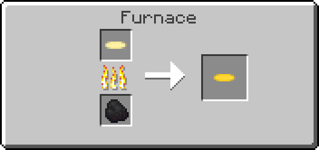<br>
      1 Raw Tortilla ➜ 1 Tortilla<br><sub>5 seconds, any fuel.</sub>
    </td>
  </tr>
</table>

#### Step 2: Fillings

<table>
  <tr>
    <td align="center" width="50%">
      <b>Ground Beef</b> · Stonecutter<br>
      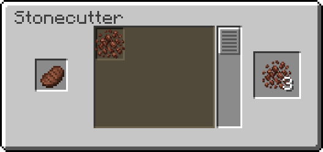<br>
      1 Cooked Beef ➜ <b>3</b> Ground Beef
    </td>
    <td align="center" width="50%">
      <b>Shredded Chicken</b> · Stonecutter<br>
      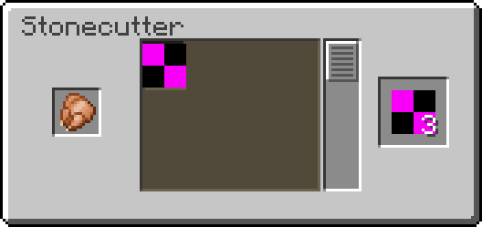<br>
      1 Cooked Chicken ➜ <b>3</b> Shredded Chicken
    </td>
  </tr>
  <tr>
    <td align="center">
      <b>Pulled Pork</b> · ✋ Inventory OK<br>
      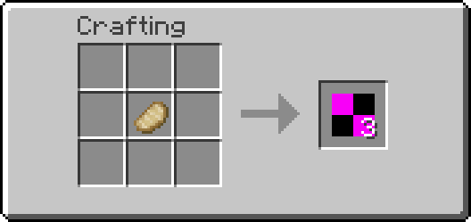<br>
      1 Cooked Porkchop ➜ <b>3</b> Pulled Pork
    </td>
    <td></td>
  </tr>
</table>

#### Step 3: Tacos

All the tacos except the Fish Taco share one shape: **3 filling across the top, a Tortilla under the middle.**

<table>
  <tr>
    <td align="center" width="50%">
      <b>Beef Taco</b><br>
      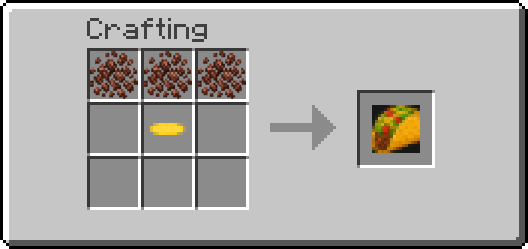<br>
      3 Ground Beef + 1 Tortilla
    </td>
    <td align="center" width="50%">
      <b>Crunchwrap Supreme</b><br>
      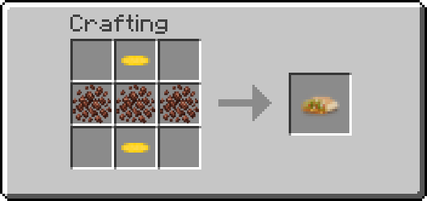<br>
      3 Ground Beef between 2 Tortillas
    </td>
  </tr>
  <tr>
    <td align="center">
      <b>Chicken Taco</b><br>
      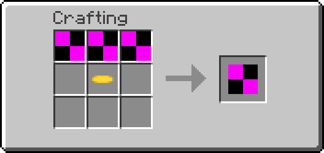<br>
      3 Shredded Chicken + 1 Tortilla
    </td>
    <td align="center">
      <b>Pork Taco</b><br>
      <br>
      3 Pulled Pork + 1 Tortilla
    </td>
  </tr>
  <tr>
    <td align="center">
      <b>Fish Taco</b> · ✋ Inventory OK<br>
      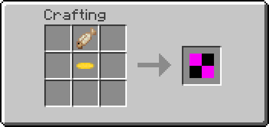<br>
      1 Cooked Cod <b>or</b> Cooked Salmon on top of 1 Tortilla
    </td>
    <td align="center">
      <b>Suspicious Taco</b><br>
      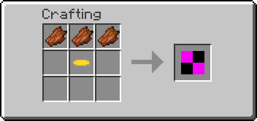<br>
      3 Rotten Flesh + 1 Tortilla
    </td>
  </tr>
</table>

#### Step 4: Sugar Cubes & Syrups

Each syrup fills all 9 slots and can go in **any layout**. You get the empty Glass Bottles back from the Honey Bottles.

<table>
  <tr>
    <td align="center" width="50%">
      <b>Sugar Cube</b><br>
      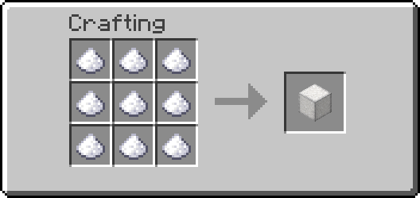<br>
      9 Sugar ➜ 1 Sugar Cube
    </td>
    <td align="center" width="50%">
      <b>Baja Blast Syrup</b> · any layout<br>
      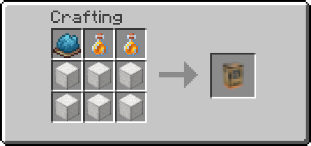<br>
      6 Sugar Cubes + 2 Honey Bottles + 1 Cyan Dye
    </td>
  </tr>
  <tr>
    <td align="center">
      <b>Mountain Dew Syrup</b> · any layout<br>
      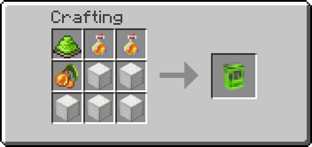<br>
      5 Sugar Cubes + 2 Honey Bottles + 1 Lime Dye + 1 Glow Berries
    </td>
    <td align="center">
      <b>Dr Pepper Syrup</b> · any layout<br>
      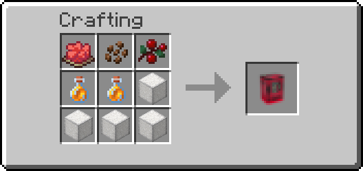<br>
      4 Sugar Cubes + 2 Honey Bottles + 1 Red Dye + 1 Cocoa Beans + 1 Sweet Berries
    </td>
  </tr>
</table>

#### Step 5: Brewing the Sodas

Put the syrup in the top slot, Water Bottles in the bottom slots, and Blaze Powder in the fuel slot. One syrup brews up to 3 bottles, so always fill all three.

> ⏳ **Sodas take 10 minutes to brew** (normal potions take 20 seconds). The stand isn't broken. Leave it running and go do something else.

<p align="center">
  <b>Baja Blast</b><br>
  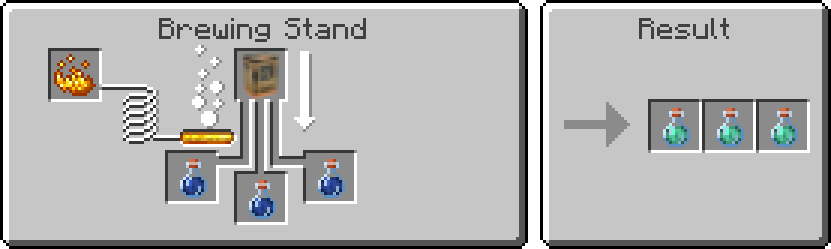
</p>
<p align="center">
  <b>Mountain Dew</b><br>
  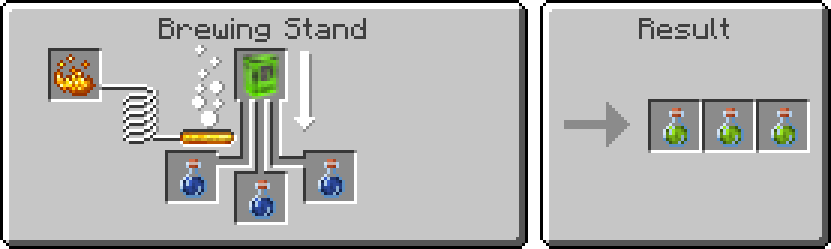
</p>
<p align="center">
  <b>Dr Pepper</b><br>
  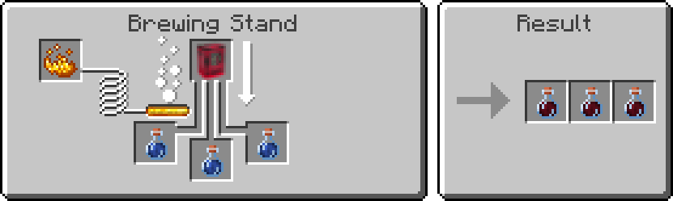
</p>

### Shopping List

Everything you need from scratch, using only vanilla items.

| To make…               | Gather                                                                          | Yield         |
| ---------------------- | ------------------------------------------------------------------------------- | ------------- |
| **Tortilla**           | 6 Wheat, 1 Water Bucket (returned), furnace fuel                                | 2 Tortillas   |
| **Beef Taco**          | 1 Cooked Beef, 1 Tortilla                                                       | 1             |
| **Crunchwrap Supreme** | 1 Cooked Beef, 2 Tortillas                                                      | 1             |
| **Chicken Taco**       | 1 Cooked Chicken, 1 Tortilla                                                    | 1             |
| **Pork Taco**          | 1 Cooked Porkchop, 1 Tortilla                                                   | 1             |
| **Fish Taco**          | 1 Cooked Cod *or* Cooked Salmon, 1 Tortilla                                     | 1             |
| **Suspicious Taco**    | 3 Rotten Flesh, 1 Tortilla                                                      | 1             |
| **Baja Blast**         | 54 Sugar, 2 Honey Bottles, 1 Cyan Dye, 3 Water Bottles, Blaze Powder            | 3 potions     |
| **Mountain Dew**       | 45 Sugar, 2 Honey Bottles, 1 Lime Dye, 1 Glow Berries, 3 Water Bottles, Blaze Powder | 3 potions |
| **Dr Pepper**          | 36 Sugar, 2 Honey Bottles, 1 Red Dye, 1 Cocoa Beans, 1 Sweet Berries, 3 Water Bottles, Blaze Powder | 3 potions |

> **Tip:** A single batch of 6 Wheat gives you 2 Tortillas, enough for two tacos or one Crunchwrap.

### Finding the Vanilla Ingredients

| Ingredient    | Where to get it |
| ------------- | --------------- |
| Honey Bottle  | Use a Glass Bottle on a full Beehive or Bee Nest (put a Campfire under it so the bees stay calm). |
| Cyan Dye      | Blue Dye + Green Dye, or a Pitcher Plant. |
| Lime Dye      | Green Dye + White Dye, or smelt a Sea Pickle. |
| Red Dye       | Poppy, Red Tulip, Rose Bush, or Beetroot. |
| Glow Berries  | Glow-berry vines in Lush Caves. |
| Cocoa Beans   | Pods growing on jungle tree trunks. |
| Sweet Berries | Bushes in taiga biomes. |
| Rotten Flesh  | Dropped by zombies. |

## Updating the Recipe Images

The pictures in this README are generated from the recipe files, so they never drift out of date. After changing a recipe or texture, run:

```sh
pip install pillow
python scripts/render_recipe_images.py
```

It borrows the vanilla GUI and item textures from your launcher's copy of the Minecraft version in `gradle.properties` (launch that version once first), or from any client jar passed with `--jar`.
